

# Future Watch

**The company website of a small multi-platform app studio: a product catalogue for 16 apps across Android, Android TV, iOS and Apple TV, per-app privacy policies, a contact form, and a private admin area that edits the catalogue without a redeploy.**

### [Live website: futurewatch.co](https://futurewatch.co)

React 18 · TypeScript · Vite · Tailwind CSS · Netlify Edge Functions · Cloudflare R2

<table>
  <tr>
    <td>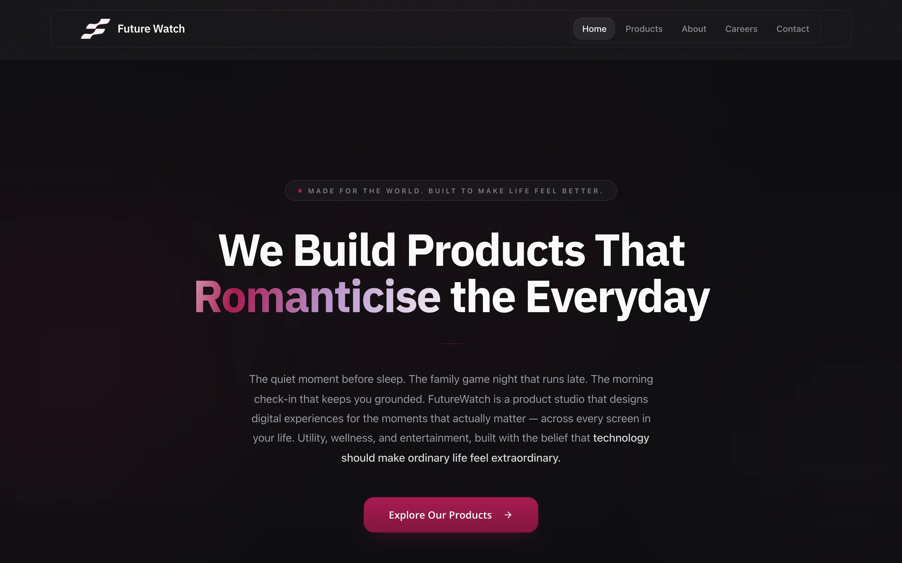</td>
    <td>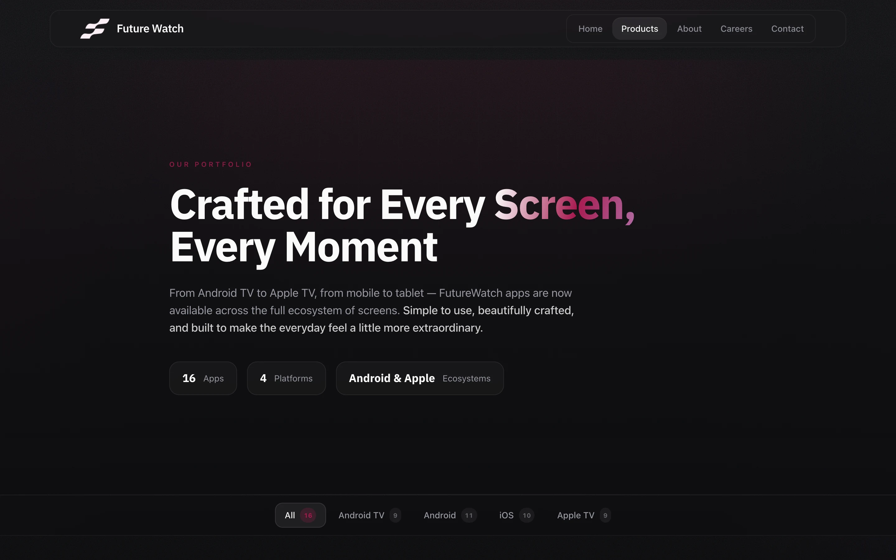</td>
  </tr>
</table>
Real captures of the live site at 1440 px wide.

---

## Product at a Glance

| | |
|---|---|
| **What it is** | Marketing and catalogue site for Future Watch, a studio that ships apps for phones, TVs and tablets |
| **Live site** | [futurewatch.co](https://futurewatch.co) (online and serving HTTP 200 when this write-up was prepared) |
| **Public pages** | Home, Products, About, Careers, Contact, site Privacy, Terms, per-app privacy policies, 404 |
| **Catalogue** | 16 apps, filterable by Android TV, Android, iOS and Apple TV, each with store badges and a privacy link |
| **Contact** | Form with required fields that sends through a hosted email service from the browser |
| **Admin** | Password-gated area (not shown) for editing the catalogue, ad-verification file, build tracking and analytics views |
| **Hosting** | Netlify (static build plus edge functions); object storage on Cloudflare R2 |
| **Code size** | About 39k lines of TypeScript across the site, admin screens and edge functions, including long-form policy text and generated UI primitives |

## Product Showcase

<table>
  <tr>
    <td align="center">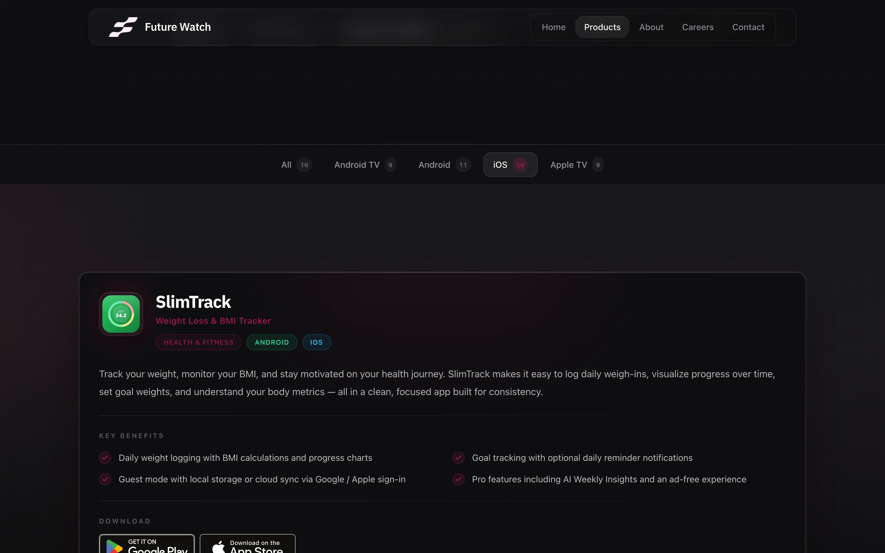 <b>Platform filter</b> Tabs with live counts</td>
    <td align="center">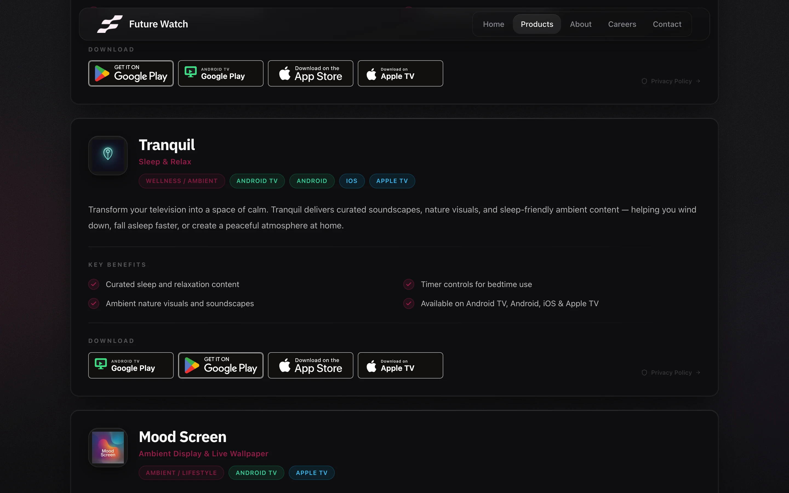 <b>Catalogue cards</b> Tags, benefits, store badges</td>
  </tr>
  <tr>
    <td align="center">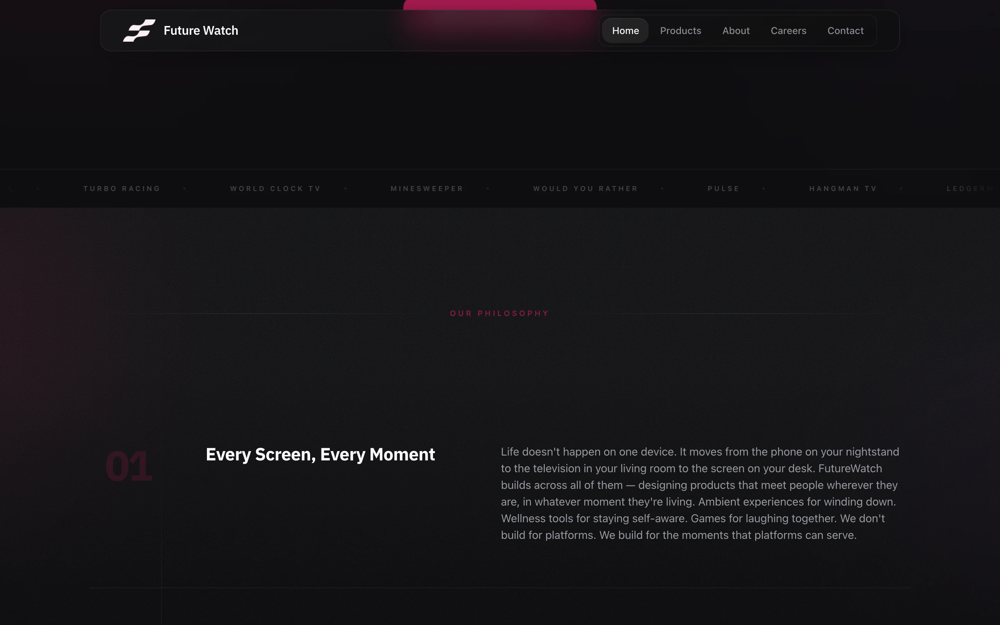 <b>Home</b> App-name marquee and philosophy section</td>
    <td align="center">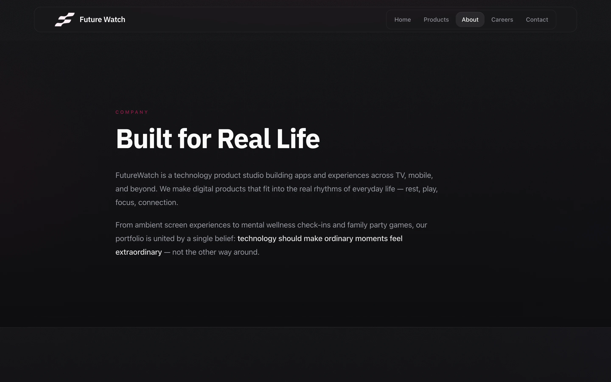 <b>About</b> Company overview</td>
  </tr>
  <tr>
    <td align="center">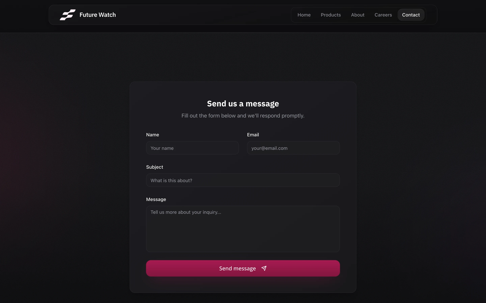 <b>Contact</b> Four-field form</td>
    <td align="center">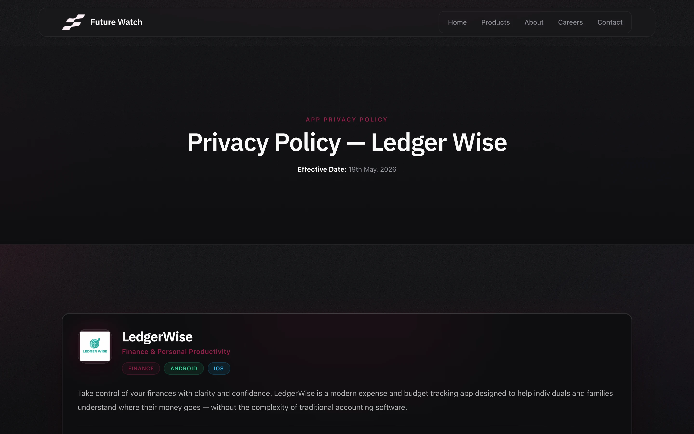 <b>Per-app privacy policy</b> Dated policy beside the app card</td>
  </tr>
</table>

### Mobile (412 x 860)

<table>
  <tr>
    <td align="center">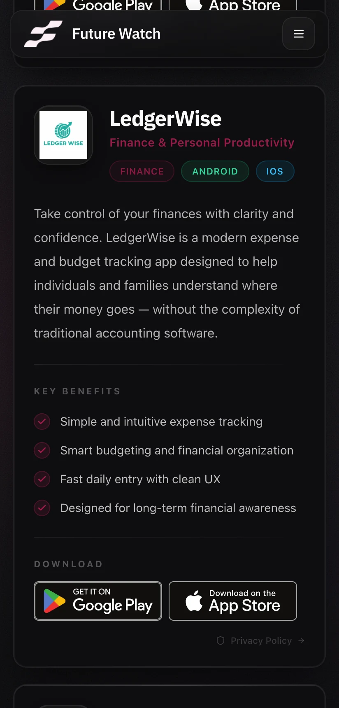 <b>Catalogue card</b></td>
    <td align="center">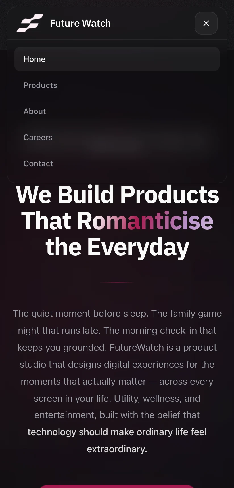 <b>Navigation menu</b></td>
  </tr>
</table>

## Key Features

- **Catalogue with platform filters.** One page lists every app; tabs for All, Android TV, Android, iOS and Apple TV show live counts and filter the list with an animated selection pill.
- **Store links that handle "coming soon".** Each app carries per-platform store links; an unreleased platform renders as a disabled badge instead of a dead link.
- **Per-app privacy policies.** Seventeen policies have stable, store-friendly URLs, with a generic `/privacy/:appId` route for apps added later and redirects for older paths. Each sets its own document title.
- **Contact form.** Name, email, subject and message (all required, checked by the browser) sent through a hosted email service, with a thank-you state.
- **Editable without redeploying.** Catalogue records live in object storage and are served by an edge function, so the public page reads fresh data at runtime.
- **Private admin area.** A password-gated section (not shown in this repository) for the catalogue, the ad-verification file, build tracking and analytics views.
- **Motion with restraint.** Shared motion tokens, scroll reveals that run once, and an operating-system reduced-motion setting honoured site-wide.

## Architecture

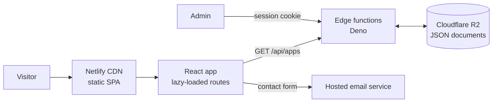

Details: [docs/ARCHITECTURE.md](docs/ARCHITECTURE.md).

## Technology Stack

| Layer | Technology |
|---|---|
| UI | React 18, TypeScript, React Router 6 |
| Styling | Tailwind CSS 3, shadcn-style components on Radix UI primitives |
| Motion | Framer Motion with shared easing and viewport tokens |
| Data | TanStack Query for the catalogue API |
| Forms | Native form with required fields; EmailJS for delivery |
| Build | Vite 5 with the SWC React plugin; route-level code splitting |
| Hosting | Netlify static hosting, redirects and headers, Netlify Edge Functions (Deno) |
| Storage | Cloudflare R2 reached with hand-written SigV4 signing |
| Admin extras | Recharts, Tiptap rich-text editor, Papa Parse |

## Engineering Highlights

### Catalogue that never renders empty
- **Problem:** the product list is edited at runtime, but the page must not flash empty or break if the API is slow or down.
- **Approach:** the page ships a bundled fallback list and swaps in the live registry once it loads. A record only appears when every required field is filled in, so half-entered apps stay hidden.
- **Outcome:** instant first paint, and publishing a new app is a data edit.

### Password gate in an edge function
- **Problem:** an admin area on a static site needs real server-side protection, and a client-side check would be decorative.
- **Approach:** an edge function runs on every request, exits early for non-admin paths, and for admin paths verifies an HMAC-derived session cookie with a constant-time comparison. Secrets are read from the host environment, never from the client bundle.
- **Outcome:** admin routes and their write APIs are unreachable without a valid session.

More: [docs/ENGINEERING_CHALLENGES.md](docs/ENGINEERING_CHALLENGES.md).

## Responsive and Design Considerations

Verified on the live site:

- A 412 px viewport has no horizontal scrolling.
- The desktop navigation collapses to a menu button with `aria-label` and `aria-expanded`.
- Store badges and benefit lists reflow on narrow screens; the filter row is horizontally scrollable when it does not fit.
- Dark theme with a single crimson accent, large headings and generous spacing.
- Reduced-motion preference respected through the animation library's global setting.

## Technical Challenges

Problem, approach and trade-off for each: [docs/ENGINEERING_CHALLENGES.md](docs/ENGINEERING_CHALLENGES.md).

## Platform and Status

| | |
|---|---|
| **Status** | In production at [futurewatch.co](https://futurewatch.co) |
| **Platform** | Web (single-page app) |

## Documentation

| Read | For |
|---|---|
| [Product overview](docs/PRODUCT_OVERVIEW.md) | Pages, features and flows |
| [Technical case study](docs/TECHNICAL_CASE_STUDY.md) | End-to-end write-up |
| [Architecture](docs/ARCHITECTURE.md) | Layers, request flows and diagram |
| [Engineering challenges](docs/ENGINEERING_CHALLENGES.md) | Problem, approach, trade-offs |
| [Privacy and source](docs/PRIVACY_AND_SOURCE.md) | What is and is not published |

## Source Code

This repository is a portfolio showcase for a production website. Production source code is maintained privately. See [RIGHTS.md](RIGHTS.md) for usage terms.
