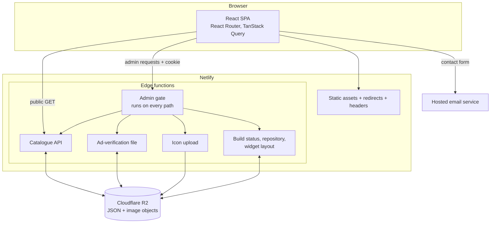

# Architecture

## Overview

A static single-page app plus a thin edge layer. The browser downloads the app from Netlify's CDN; dynamic data and the admin gate run in Netlify Edge Functions (Deno), which read and write JSON documents in Cloudflare R2.

## Layers

| Layer | Responsibility |
|---|---|
| Shell | Layout, navigation, animated page transitions, decorative backdrop, reduced-motion setting |
| Pages | Lazy-loaded routes: public pages, per-app policy routes, admin routes |
| Data | TanStack Query hook for the public catalogue; fallback list bundled with the page |
| Edge | Admin gate and small JSON handlers; shared helpers for session cookies and R2 signing |
| Storage | Cloudflare R2 documents for catalogue records, ad-verification content, build and layout state |
| Hosting config | SPA fallback redirect, security and cache headers for the admin path |

## Request flows

### Public catalogue
1. Browser loads the shell and the Products chunk.
2. The page renders the bundled fallback list immediately.
3. The query fetches `/api/apps`; if records come back, they replace the fallback after filtering out hidden or incomplete entries and entries scoped to another storefront.

### Admin request
1. Every request enters the gate function, which returns immediately for non-admin paths.
2. For admin paths it computes the expected session token from the configured password and compares it with the cookie in constant time.
3. Unauthenticated requests are redirected to the login page; a successful login sets a session cookie with a seven-day lifetime. Authenticated responses are marked no-store and non-frameable.
4. Write endpoints repeat the cookie check themselves, so they are protected even if the gate path rules change.

### Contact form
The form posts directly from the browser to the hosted email service using public service identifiers injected at build time. No site-owned server handles the message.

## Routing

- Public routes are declared in one router; every page is `React.lazy`.
- Seventeen canonical policy routes plus legacy redirects come from a single policy map, so adding an app adds its route.
- A catch-all rewrite to the shell makes deep links work.

## Design decisions

- **Edge instead of a server.** The only dynamic needs are a small JSON read and a gated write path. Edge functions keep the whole site on one platform.
- **One document per concern in R2.** Whole-document replace keeps handlers simple; the cost is last-write-wins, acceptable for a single-editor admin.
- **Fallback data in the bundle.** Trades a little duplication for a page that always renders.
